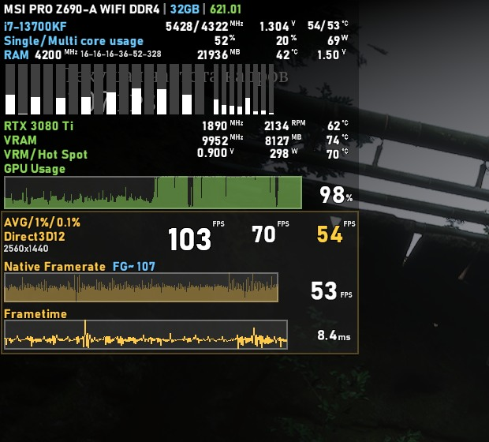
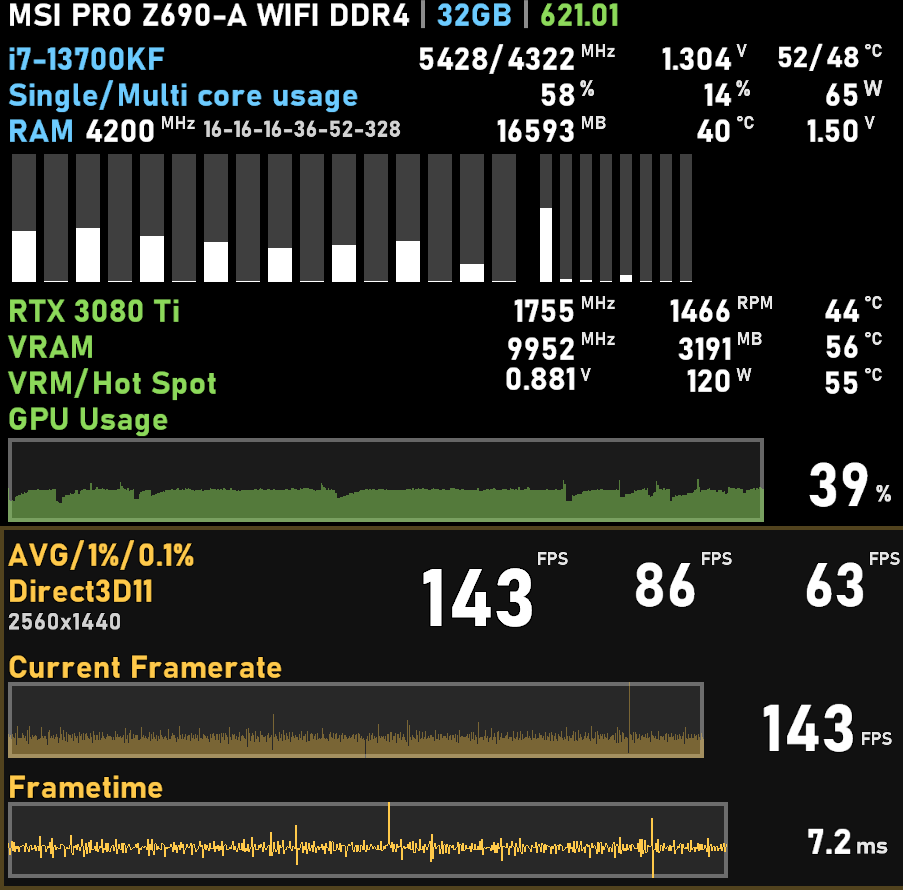
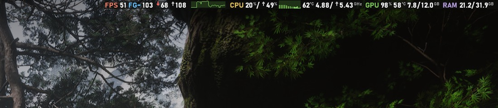
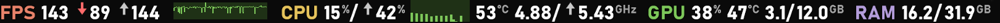

**Русский** | [English](README.en.md)

# RTSS Overlay Preset

Готовый оверлей мониторинга для **RivaTuner Statistics Server**: процессор, память с живыми таймингами, видеокарта,
загрузка каждого потока, FPS / 1% / 0.1% low / frametime. Ставится одним файлом и сам подстраивается под ваше железо.
Два вида: **большой** — в стиле i2HARD и **компактная строка** — в стиле оверлея Steam, с нативным FPS при генерации кадров.

> **Вдохновлено [i2HARD](https://www.youtube.com/@i2hard)** — именно так оверлей настраивают в их тестах железа. Это не официальный
> проект i2HARD, а пресет в их стиле, сделанный с уважением к их работе.

| В игре (Black Myth: Wukong, генерация кадров FSR 3, 2560×1440) | Крупным планом |
|:---:|:---:|
|  |  |

**Компактная строка** в стиле Steam Performance Monitor — в игре (реальный FPS 51, с генерацией `FG≈103`) и крупным планом:

## Главное

- **Нужен только RTSS.** HWiNFO, AIDA64 и MSI Afterburner не нужны: датчики берутся из модуля LibreHardwareMonitor,
  встроенного в RTSS, и драйвера PawnIO (он есть в архиве и ставится сам).
- **Подстраивается под ПК.** Установщик определяет процессор, видеокарту, плату и память. Датчиков, которых у вас нет
  (температура ОЗУ, Hot Spot и т. п.), в оверлее не будет; полосок загрузки ровно столько, сколько потоков;
  подписи окрашены в цвета производителя: Intel — голубой, AMD — красный, NVIDIA — зелёный, Intel Arc — синий.
- **Живые тайминги памяти** прямо из контроллера: Intel Core 6–14 поколения, AMD Ryzen (Zen 2–5, DDR4 и DDR5).
- **Ничего не вылезает за рамки** — даже 1000+ FPS, 28000 МГц памяти или 100 °C.
- **Цвет-предупреждение:** перегрев и низкий FPS подсвечиваются жёлтым и красным.
- **Два шрифта на выбор:** Bahnschrift (по умолчанию) и Unispace (классика).
- **Два вида:** большой и компактная строка в стиле Steam. Ставятся оба сразу, переключаются по кругу одной клавишей (Scroll Lock) прямо в игре.
- **Нативный FPS при генерации кадров** (в обоих видах): как Steam, показывает реальную частоту кадров игры и итоговую
  с DLSS FG / FSR FG / AFMF / Smooth Motion — подробнее [ниже](#генерация-кадров).
- Установщик и документация — на русском и английском.

## Установка

1. Установите **RTSS 7.3.7 или новее** — отдельно, [с сайта Guru3D](https://www.guru3d.com/download/rtss-rivatuner-statistics-server-download/).
   MSI Afterburner для этого не нужен.
2. Скачайте архив (**Code → Download ZIP** или последний релиз) и распакуйте.
3. Запустите **`install.bat`** и подтвердите права администратора.
4. Выберите язык, шрифт и горячие клавиши — остальное установщик сделает сам. Ставятся оба вида оверлея.

Подробно, в том числе **ручная установка** без установщика: [docs/INSTALL.md](docs/INSTALL.md).
**Как подредактировать оверлей под себя:** [docs/CUSTOMIZE.md](docs/CUSTOMIZE.md).

Удаление — `uninstall.bat`: всё возвращается как было до установки.
После обновления RTSS запустите `install.bat` ещё раз.

## Горячие клавиши

Назначаются во время установки — просто нажмите нужное сочетание.

| Действие | По умолчанию | Что делает |
|---|---|---|
| Показать / скрыть оверлей | Ctrl+Alt+Num 0 | включает и выключает оверлей в игре |
| Сброс статистики | Ctrl+Alt+Num 1 | обнуляет средний FPS, 1% и 0.1% low. Они считаются с запуска игры, и загрузки, ролики и меню их портят — нажмите после загрузки уровня, и статистика пойдёт только по геймплею. Первые секунды после сброса 1% и 0.1% показывают 0 — это нормально |
| Скриншот | Ctrl+Alt+Num 2 | снимок экрана вместе с оверлеем в папку `Изображения\RTSS Screenshots` |
| Оверлей: левый ↔ правый край | Ctrl+Alt+Num 4 | переносит оверлей к противоположному краю экрана |
| Оверлей: верх ↕ низ | Ctrl+Alt+Num 8 | переносит оверлей к верхнему или нижнему краю; вместе с предыдущей — в любой угол |
| Переключить вид | Scroll Lock | по кругу: большой → компактная строка → большой. Только одна клавиша без Ctrl/Alt — так RTSS считает нажатия; подойдёт любая, которая не нужна в играх (Scroll Lock, Pause) |

Какой вид основной — показан после запуска RTSS — установщик спрашивает (по умолчанию большой).
Как устроено переключение и как поменять клавишу вручную — [docs/CUSTOMIZE.md](docs/CUSTOMIZE.md#как-устроено-переключение-видов).

## MSI Afterburner

Afterburner **не обязателен** — RTSS ставится и работает без него. Если он у вас есть (для разгона или вентиляторов),
пользуйтесь им как обычно. У Afterburner есть свой оверлей, который рисуется поверх этого; если он включён,
установщик выключает **только его** (вывод датчиков в оверлей) — разгон, кривые вентиляторов и мониторинг не трогаются.

Для разгона и андервольта видеокарт **NVIDIA RTX 20 / 30 / 40 / 50** вместо Afterburner рекомендуем
[NV-UV](https://github.com/christianp403-spec/NV-UV) и [NV-UV-Play](https://github.com/christianp403-spec/NV-UV-Play).

## Что показывается

| Блок | Данные |
|---|---|
| Заголовок | материнская плата, объём ОЗУ, версия драйвера NVIDIA |
| CPU | частота (P/E для гибридных Intel), Vcore, температура, загрузка (макс. поток / общая), мощность |
| RAM | частота, тайминги tCL-tRCD-tRP-tRAS-tRC-tRFC, занято, температура модулей, напряжение |
| Потоки | загрузка каждого потока (P- и E-ядра отдельными блоками) |
| GPU | частота, обороты, температура, частота / объём / температура памяти, напряжение, мощность, Hot Spot, загрузка |
| FPS | средний, 1% и 0.1% low, текущий, графики FPS и frametime, API, разрешение |

Компактная строка: `FPS текущий ↓1% low ↑максимум` · график FPS · `CPU общая/↑макс. поток` · загрузка каждого потока ·
температура CPU · `средняя/↑макс. частота` · `GPU загрузка, температура, видеопамять занято/всего` · `RAM занято/всего`.
График FPS в ней — по точке на обновление (два раза в секунду), около 40 секунд истории (как у Steam); полоски потоков желтеют от 70 %
и краснеют от 90 % загрузки.

### Генерация кадров

С генерацией кадров RTSS показывает итоговый FPS, а не реальный: «90 FPS» с генерацией — это 45 кадров игры
и 45 сгенерированных. Оверлей различает их тремя способами:

1. **Драйверная генерация** (AMD AFMF, NVIDIA Smooth Motion) — на экран выводится больше кадров, чем отдаёт игра;
   это видно по данным **PresentMon** (входит в RTSS), реальный FPS измеряется точно.
2. **Генерация внутри игры** (FSR, DLSS, XeSS) — PresentMon её не помечает, поэтому нужны два признака сразу:
   у игры есть библиотека генерации (это проверяет `Exporter.dll` пресета: DLL генерации или встроенный FSR 3
   в самой игре) **и** ритм кадров — каждый второй кадр гораздо легче для видеокарты. Реальный FPS тогда — итоговый
   пополам, это оценка, поэтому она помечена **`FG≈`**.
3. Признак должен держаться большую часть последних 5 секунд — короткие скачки его не включают.

Что видно на экране:
- **большой оверлей** — крупное число под графиком становится реальным FPS игры, подпись над графиком —
  `Native Framerate  FG≈ 90` (итоговый FPS с генерацией);
- **компактная строка** — `FPS 45 FG≈ 90 ↓… ↑…`.

Графики FPS и frametime большого вида при генерации выглядят «расчёской», а frametime может показывать доли миллисекунды:
RTSS меряет время между выводами кадров, а сгенерированный кадр выводится почти сразу за настоящим. На экране кадры
идут ровно. Перерисовать графики по данным PresentMon пробовали — они приходят пачками с задержкой, и графики
дёргаются, поэтому пока так.

Проверено на RTX 3080 Ti: Black Myth: Wukong (встроенный FSR 3) и The Witcher 3 с модом RTX 30 Frame Generation
(DLSS FG) — с генерацией `FG≈` и реальный FPS вдвое ниже итогового, без генерации — обычный вид. AFMF и Smooth Motion
пока не проверялись. Steam определяет генерацию иначе —
перехватывает в игре вызовы библиотек DLSS и FSR 3.1+; встроенный в игру FSR 3.0 (как в Wukong) он не видит.

Как это устроено и как поменять пороги — [docs/CUSTOMIZE.md](docs/CUSTOMIZE.md#генерация-кадров).

### Поддерживаемое железо

| | |
|---|---|
| Процессоры | Intel Core 6-го поколения и новее, Core Ultra; AMD Ryzen. Тайминги — Intel Core 6–14 и Ryzen Zen 2–5 |
| Видеокарты | NVIDIA GeForce, AMD Radeon, Intel Arc и встроенная графика Intel / AMD |
| Платы | любые, где LibreHardwareMonitor видит чип мониторинга (Nuvoton, ITE, Fintek…); без него не будет Vcore и напряжения памяти |

## Если что-то не так

Запустите `installer\Detect.ps1 -Export` (PowerShell от администратора) и приложите появившийся
`installer\hardware-report.json` к [issue](../../issues).

**Генерация кадров перестала определяться или «FG» мигает с неверным FPS.** Данные о кадрах приходят из системной
трассировки событий Windows (через PresentMon). Если Windows долго не перезагружалась, а программы мониторинга
кадров много раз запускались и закрывались, трассировка может начать терять события: PresentMon видит меньше кадров,
чем RTSS, а время работы видеокарты становится бессмысленным. Помогает перезагрузка ПК.

## Лицензии

Файлы проекта — MIT (`LICENSE`). Вшитые сторонние компоненты (LibreHardwareMonitor, PawnIO и др.) распространяются
на своих лицензиях — см. [THIRD-PARTY-NOTICES.md](THIRD-PARTY-NOTICES.md) и папку `licenses`.

---

## Другие мои проекты

- **[Nilesoft Shell Preset](https://github.com/SolidSnake1765/nilesoft-shell-preset)** — FFmpeg в контекстном меню Windows:
  конвертация, сжатие и обрезка видео, аудио и картинок (видеокарты NVIDIA, AMD, Intel). Пресет Nilesoft Shell.
- **[Local VOT](https://github.com/SolidSnake1765/local-vot)** — закадровый перевод своих видео на русский голосами Яндекса
  (через Яндекс Диск или Google Диск), приложение для Windows.
- **Snake VPN** — мой личный VPN-сервис для россиян:
  - [Бот в Telegram](https://t.me/SnakeVPNServiceBot).
  - [snakeservice.tech](https://snakeservice.tech) — сайт сервиса. Можно пользоваться вместо бота, а можно вместе с ним:
    подписка, устройства, оплата, поддержка. Зарегистрироваться можно через Google или Discord, Telegram не обязателен.
  - [free.snakeservice.tech](https://free.snakeservice.tech) — бесплатные прокси для Telegram. Раньше они были внутри бота,
    теперь на отдельном сайте. Подписка для них не нужна, так что сохраните ссылку и кидайте друзьям —
    выручает, когда Telegram не открывается.
